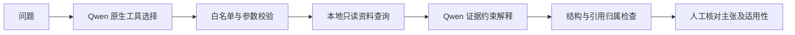

# Vehicle Diagnosis Agent

新能源汽车故障资料辅助分析项目，使用 **RAG、LangGraph、Qwen 原生工具调用、MCP 与人工审批**，实现有来源约束的资料解释、可恢复工作流和本地工单提交。


## 已实现

- **RAG 与检索评测**：100 篇官方资料中文摘要、350 条检索题；对比 BM25、向量召回与 RRF，区分开发/冻结测试集，检查文档级和证据片段级指标。
- **状态化工作流**：LangGraph 类型状态、信息补问、工具参数校验、允许列表、调用预算、重复拒绝和失败转人工。
- **持久审批与工单**：SQLite checkpoint 跨进程恢复，`approve / edit / reject`，批准快照校验与幂等工单提交。该模块当前通过 CLI 独立运行。
- **MCP 与服务化**：独立 stdio DTC 查询服务、FastAPI 单次只读诊断、Docker Compose、依赖锁定和本地 CI 等价脚本。DTC、车辆历史和库存为显式模拟目录。
- **真实模型工具调用**：Qwen `auto` 原生 tool calling 选择白名单查询；受控 Python 校验后执行本地审核摘要查询，自动回传工具结果并生成 JSON 解释。上限为两次模型请求、一次只读查询，结果检查结构和引用归属。

## 快速验证：无需模型密钥

Python 3.11；以下步骤不调用真实模型、不下载向量模型。

```bash
python -m venv .venv
source .venv/bin/activate
python -m pip install -r requirements-ci.txt
python scripts/run_agent_ci.py
```

当前快照本地通过 **504 项离线测试**（492 项 Agent + 12 项旧 RAG）及 **20 条基础工作流案例**，详见 [验证报告](docs/validation/local_validation.json)。Agent CI 排除旧 RAG 的 `test_api.py`、`test_llm.py`；旧 RAG 的依赖与运行方式见 [早期 RAG 手册](docs/EARLY_RUNBOOK.md)。

启动只读 HTTP/MCP 服务：

```bash
docker compose up -d --build --wait
```

打开 `http://127.0.0.1:8002/docs`。容器入口为 `app.agent_api:app`；`/health` 是存活检查，`/diagnose` 是第四周的单次只读流程，不是第五周待建的任务/审批 API。基础容器不包含第五周模型 CLI 所需的完整资料目录，模型 CLI 请在本机执行。

## 跨进程恢复、人工审批与幂等

```bash
python scripts/run_week4_demo.py
```

阅读草稿后输入 `approve` 继续；其他输入取消。每次建立独立演示数据库，分别验证跨进程恢复、MCP、故障复核、审批和重复提交保护。使用 `--base-url http://127.0.0.1:8002` 可增加 HTTP 检查。

教学自动批准必须显式添加 `--scripted-review`，不将自动预设当作真人审批。架构与边界见 [项目状态](docs/PROJECT_STATUS.md)。

## 真实 Qwen 原生工具调用

该路径会调用配置的模型服务并可能产生费用；离线测试不执行此命令。

```bash
python -m pip install python-dotenv
cp .env.example .env
# 只在本机 .env 配置 DASHSCOPE_API_KEY
python -m scripts.week5_tool_call_smoke
python -m scripts.week5_read_only_smoke
```

第一条检查一次原生工具选择；第二条自动回传证据并生成带引用 JSON。真实烟测场景为合成问题 + 本地人工审核摘要 + 真实 Qwen 服务，不代表在线厂家数据库或实车诊断。



有效引用不能自动证明主张正确。无法确认部件损坏时保留不确定性；资料中的指令不授予模型执行权限。

## 评测与工程证据

- [本次快照离线测试与流程验证](docs/validation/local_validation.json)
- [检索与模型调用评测说明](docs/EVALUATION.md)
- [资料来源、数据类型与使用边界](docs/DATA_SOURCES.md)
- [当前状态与后续工作](docs/PROJECT_STATUS.md)
- [可用于简历的项目描述](docs/RESUME.md)

历史检索报告在 `evaluation/week2/results/`；第三周 20 条工作流用例在 `evaluation/week3/agent_cases.json`。第五周 20 条业务开发案例目前为 **not_run**，不能与第三周流程验收混为一谈。

## 项目结构

```text
app/                  状态图、工具门禁、MCP、审批、模型调用与契约
tests/                离线单元、契约、异常、跨进程与 API 测试
scripts/              本地 CI、验收、恢复/审批与模型烟测入口
data/documents/       12 篇带来源的中文摘要
evaluation/week2/     检索题集、冻结信息与历史对照报告
evaluation/week3/     工作流用例
evaluation/week5/     审核来源清单、业务开发案例与有限摘录
learning/             模块说明与实现边界
docs/                 发布说明、验证摘要与简历描述
```

## 当前限制

项目是持续开发中的工程实践，尚无实车准确率、企业生产部署或企业工单接入结论。诊断图与审批图仍为独立模块；第五周模型 CLI 尚未接统一任务 API。多 Agent、PostgreSQL/Redis、LoRA 和硬件联动属于后续阶段，未列为当前成果。

依赖/镜像和本地 CI 已有验证，**GitHub Actions 当前未启用**：现有发布凭据不具备 `workflow` 权限，因此 CI 配置仅作为 [工作流模板](docs/ci/agent-ci.yml.example) 随文档提供，没有写入 `.github/workflows/`。后续取得所需授权并验证后再启用；模板存在不等于云端执行通过。项目尚未选择开源许可证；资料权利分别属于其原作者/权利人。
