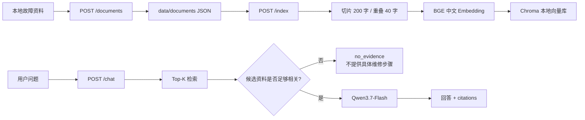

# Vehicle Diagnosis Agent：车辆诊断工作流演示

> 历史手册：当前发布范围和第五周进度以仓库根目录 README 为准。以下保留当时的模块运行方法；私人学习记录不随公开包发布。

使用 LangGraph 组织信息补问、只读模拟工具、资料检索与故障复核，提供独立 stdio MCP 和 FastAPI/Docker 入口。工单模块支持 SQLite 持久化审批与幂等写入。当前诊断路由由确定性规则驱动；第一、二周的 Chroma/Qwen RAG 服务继续保留。

第一、二周的公开指标见 [评测说明](EVALUATION.md)，私人学习过程记录不随公开包发布。

## 第四周本地阶段演示

```bash
python scripts/run_week4_demo.py
```

展示跨进程恢复、MCP、故障复核、审批与工单幂等；读取草稿后输入 approve 继续。每次使用独立演示目录，不改已有 checkpoint 或工单库。可增加 `--base-url http://127.0.0.1:8002` 验证已启动的容器。

讲解稿、证据位置与功能边界见 [五分钟阶段演示](../learning/week4/stage_demo.md)。上传/CI 状态为原阶段记录，当前状态见根目录 README。

## 第四周 Agent HTTP 入口

当前单次只读诊断服务入口为 `app.agent_api:app`，通过 stdio MCP 查询模拟 DTC，再检索第二周固定语料。

```bash
python -m uvicorn app.agent_api:app --host 127.0.0.1 --port 8001
```

保持终端运行后访问：

- [存活检查](http://127.0.0.1:8001/health)：返回 `{"status":"ok"}`，仅检查 HTTP 进程。
- [交互文档](http://127.0.0.1:8001/docs)：在 `POST /diagnose` 中使用 Try it out。

请求示例：

```json
{"vehicle_id":"VIN-DEMO-001","symptom":"仪表提示绝缘故障","dtc_codes":["P0AA6"]}
```

当前资料没有匹配的 P0AA6 证据，预期工具 success、调用 1 次、结果 no_evidence。工具数据源在响应中标记为 mock。该接口每次请求独立初始化状态，一次最多查询一个 DTC；checkpoint、工单审批与正式提交仍通过已提供的 CLI 演示。

定向测试：`python -m pytest tests/test_agent_api.py -q`。完整任务、故障状态与范围见 [Agent API 学习说明](../learning/week4/agent_api.md)。本地 HTTP 已由学习者验收。Docker Compose 与本地 CI 配置及验收步骤见下文；云端运行需单独验收。

## Docker Compose 启动只读 Agent

```bash
docker compose up --build -d --wait
docker compose ps
```

使用 http://127.0.0.1:8002/health 和 http://127.0.0.1:8002/docs 验收，避免与已有本地 8001 服务冲突。停止命令：`docker compose down`。首次构建需联网；运行不需要 Qwen API Key 或模型下载。

镜像仅纳入运行代码与第二周固定清单/语料，不包含 .env、checkpoint 或工单库。运行版本已通过 requirements-agent.lock.txt 固定，构建同时检查直接依赖清单；说明见 [依赖锁定](../learning/week4/dependency_lock.md)。容器使用非 root、只读根文件系统。已在本机 linux/arm64 实际构建及验收通过；历史全量 270 passed。临时验收容器已关闭，保留镜像。本步范围和三种诊断验收见 [容器学习说明](../learning/week4/docker_compose.md)。

## Agent CI 检查

```bash
python scripts/run_agent_ci.py
python scripts/check_agent_http.py --base-url http://127.0.0.1:8002
```

第一条运行 Agent 测试及 20 条工作流案例，第二条检查已经启动的容器。报告目录 evaluation/week4/ci-runs/ 已忽略。早期向量 RAG API/LLM 两个测试文件不在此轻量 CI 范围内，原完整回归仍为 `python -m pytest -q`。

GitHub Actions 配置已放在 .github/workflows/agent-ci.yml；本段为历史状态，云端 CI 运行需单独验收。范围、报告及后续接入见 [CI 学习说明](../learning/week4/ci.md)。

## 早期 RAG 功能

- FastAPI 接口：`/health`、`/documents`、`/index`、`/search`、`/chat`
- 本地 JSON 文档与统一元数据
- 中文文本切片、`BAAI/bge-small-zh-v1.5` Embedding、Chroma Top-K 检索
- 阿里云百炼 `qwen3.7-flash` 回答生成
- 返回可追溯的来源、文档 ID 与片段 ID
- 无充分证据时不生成具体维修步骤
- 超时、空模型响应与非法输入处理
- 覆盖 RAG、诊断图、checkpoint、人工审批、幂等存储、MCP 与 HTTP API 的自动化测试，以及第一周固定问题验收集

## 早期 RAG 架构



## 环境准备

建议使用 Python 3.11：

```bash
conda create -n vehicle-agent python=3.11 -y
conda activate vehicle-agent
pip install -r requirements.txt
```

创建 `.env` 文件，填入自己的百炼配置：

```text
DASHSCOPE_API_KEY=你的API_KEY
DASHSCOPE_BASE_URL=https://dashscope.aliyuncs.com/compatible-mode/v1
DASHSCOPE_MODEL=qwen3.7-flash
```

`.env` 已被 `.gitignore` 排除，严禁将 API Key 写入源码或提交到版本库。

## 启动早期 RAG 服务

```bash
uvicorn app.main:app --reload
```

打开交互式接口文档：

```text
http://127.0.0.1:8000/docs
```

## 使用流程

1. 用 `POST /documents` 导入资料。
2. 用 `POST /index` 建立或重建 Chroma 索引。
3. 用 `POST /search` 检查检索结果。
4. 用 `POST /chat` 获取基于资料的回答和引用。

示例问题：

```json
{
  "question": "绝缘故障应该先做什么？"
}
```

成功回答示例结构：

```json
{
  "answer": "基于资料的回答……",
  "citations": [
    {
      "source": "demo/isolation_fault.md",
      "chunk_id": "文档ID:0",
      "title": "动力电池绝缘故障处理规范",
      "document_id": "文档ID"
    }
  ],
  "status": "ok"
}
```

资料不足时：

```json
{
  "answer": "资料库中没有足够证据，无法提供具体维修步骤。",
  "citations": [],
  "status": "no_evidence"
}
```

## 测试与验收

运行自动化测试：

```bash
python -m pytest -q
```

当前结果：`269 passed`（2026-10-15）。旧文档导入测试使用临时目录，避免修改正式语料。

运行 20 条固定问题验收：

```bash
python scripts/run_evaluation.py
```

验收结果写入：

```text
evaluation/results.json
```

本轮批量结果为 19/20 通过；Q05 在独立复测中通过，批量中的一次误判记录为模型输出的非确定性波动。

## 第二周：可复现检索评测

`evaluation/week2/` 固定了 `week2-v1.0` 数据集：12 篇纳入语料、60 道带证据标注题目、40 道开发题和 20 道冻结测试题。语料来源、版本、划分与文件哈希分别见 `corpus_manifest.csv`、`SOURCE_NOTES.md`、`splits.json` 和 `freeze_manifest.json`。

一条命令重跑隔离的开发集向量基线：

```bash
conda run -n vehicle-agent python scripts/run_retrieval_evaluation.py --split development
```

它验证冻结哈希，只读取清单中 `include` 文档，生成独立 `.npz` 索引，并将逐题结果、Recall@1/3/5、MRR 和延迟写入 `evaluation/week2/results/vector_baseline_development.json`。指标要求命中包含标注证据的片段；无证据题单独报告候选返回率，不混入召回指标。冻结测试集受命令行保护，最终评测时才显式运行：

```bash
conda run -n vehicle-agent python scripts/run_retrieval_evaluation.py --split frozen_test --allow-frozen-test
```

运行同一开发集上的 BM25 基线：

```bash
conda run -n vehicle-agent python scripts/run_bm25_evaluation.py --split development
```

BM25 使用中文逐字分词、英文和数字连续保留，参数固定为 `k1=1.2`、`b=0.75`；逐题排序、指标和运行元数据写入 `evaluation/week2/results/bm25_development.json`。冻结测试集沿用相同的显式保护：

```bash
conda run -n vehicle-agent python scripts/run_bm25_evaluation.py --split frozen_test --allow-frozen-test
```

运行 RRF 混合检索开发集评测（先运行两个基线，以便读取其逐题排序）：

```bash
conda run -n vehicle-agent python scripts/run_hybrid_evaluation.py --split development
```

RRF 只融合名次，不直接相加向量相似度与 BM25 原始分数：`1 / (60 + vector_rank) + 1 / (60 + bm25_rank)`。结果保存在 `evaluation/week2/results/hybrid_rrf_development.json`；冻结测试集同样要求 `--allow-frozen-test`。

每份第二周结果还同时记录两层指标：`metrics` 是命中包含完整标注证据的片段的严格 evidence-chunk Recall；`document_metrics` 只要求命中标注文档。两者的差异能识别重叠切片中“找到了正确资料但未排出完整证据片段”的情况。

运行 12 道开发集题的回答评测：

```bash
conda run -n vehicle-agent python scripts/run_answer_evaluation.py --split development
```

该命令使用 BM25 Top-3 片段调用已配置的模型，并将回答、内联引用和自动核验结果写入 `evaluation/week2/results/answer_evaluation_development_prompt_v4.json`。人工主张复核另存为 `answer_evaluation_development_prompt_v4_manual_review.json`；它只读取开发集抽样题，冻结测试集仍受 `--allow-frozen-test` 保护。

## 已知限制与下一步

- 当前资料量较少，向量距离不能单独作为“有无证据”的可靠判据。
- 当前通过“候选资料 + Qwen 证据门控”处理无证据场景。
- 第二周的方案已冻结：回答使用 BM25 Top-3、原文顺序的连续重叠片段和 `week2-answer-v4` 提示词。开发集抽样回答 12/12 状态正确，且 8/8 有证据题引用完整证据；冻结测试集结果仅作最终报告，不再用于调参。
